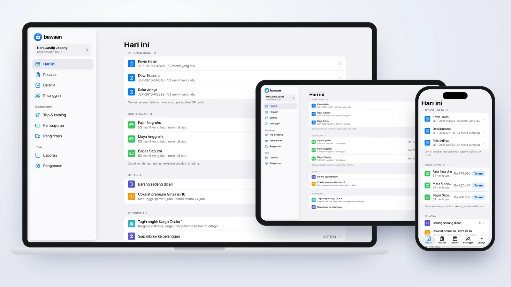
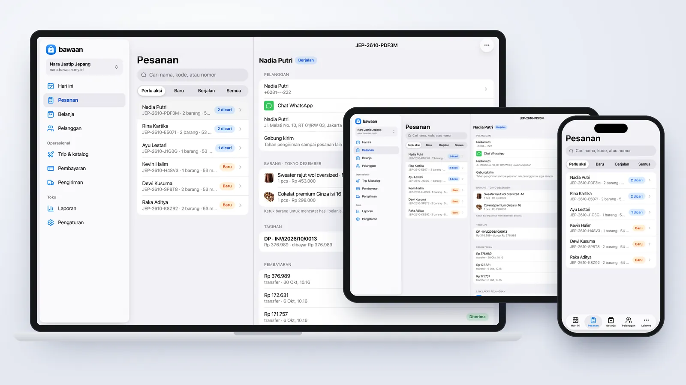
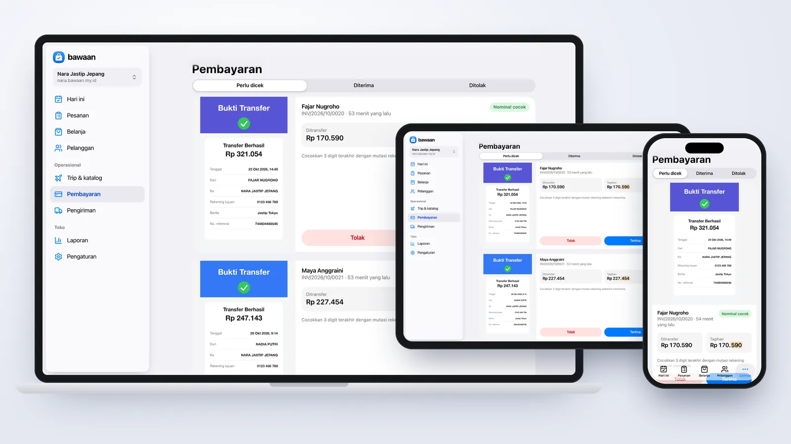
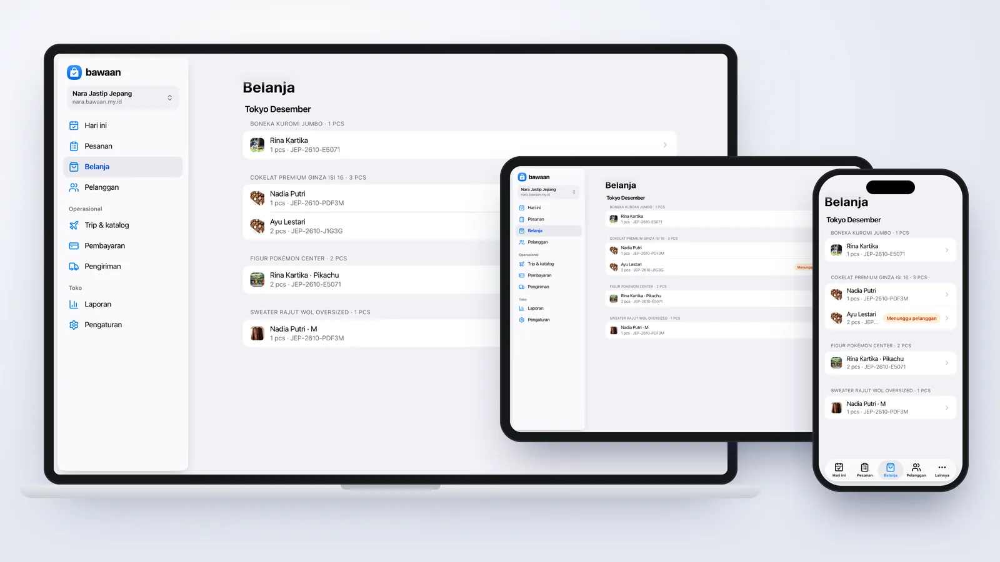
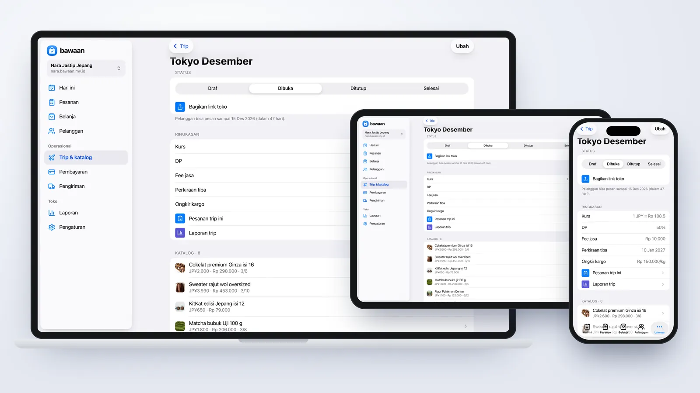
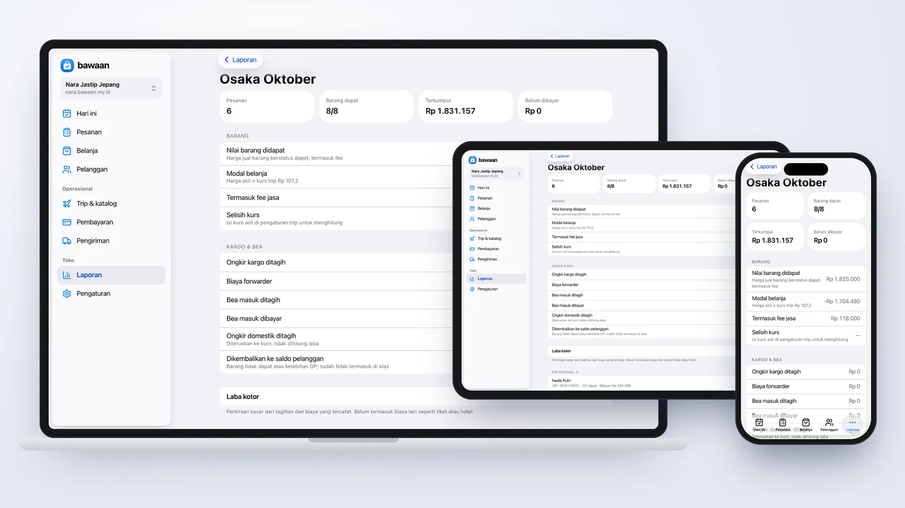
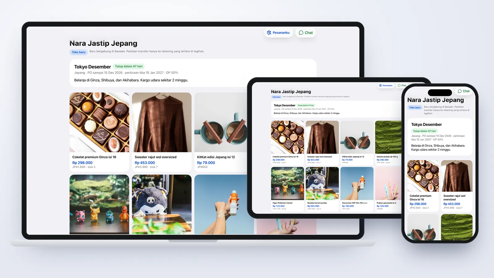
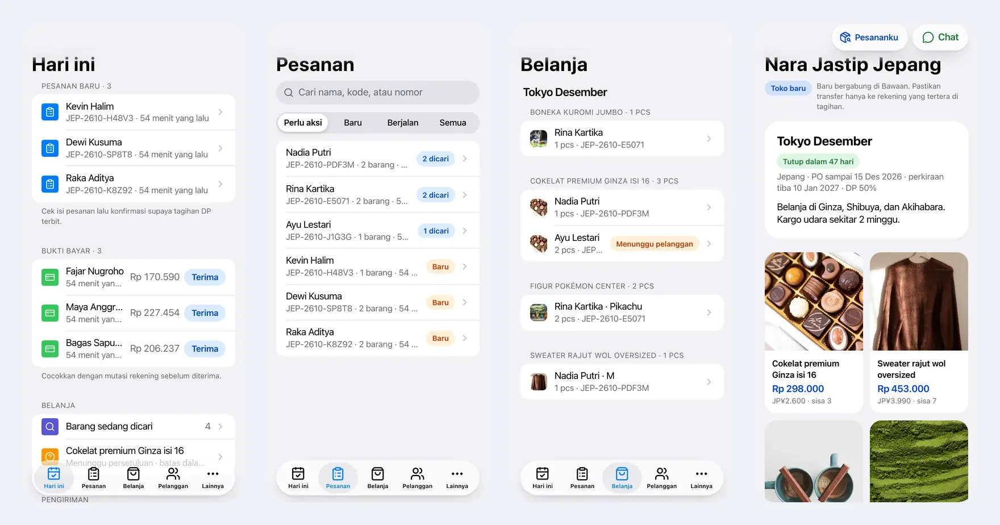

# Bawaan

Aplikasi untuk seller jasa titip (jastip): buka PO per trip, terima pesanan dari toko online sendiri, tagih DP dan pelunasan, cek bukti bayar, belanja dengan daftar yang bisa dipakai offline, sampai kirim barang ke pelanggan. Dibangun dengan React + Vite di Cloudflare Workers, D1, dan R2.

[](https://react.dev)
[](https://vite.dev)
[](https://www.typescriptlang.org)
[](https://tailwindcss.com)
[](https://hono.dev)
[](https://developers.cloudflare.com/workers/)
[](https://orm.drizzle.team)
[](./LICENSE)
[](https://demo.bawaan.my.id)



---

## Preview

Tangkapan layar dari data contoh "Nara Jastip Jepang". Desktop memakai sidebar, tablet memakai sidebar yang bisa dibuka-tutup, dan ponsel memakai large title dengan tab bar mengambang.

| Pesanan | Cek bukti bayar |
|---|---|
|  |  |
| **Daftar belanja** | **Trip & katalog** |
|  |  |
| **Laporan trip** | **Toko online pelanggan** |
|  |  |

### Mobile



---

## Fitur

### Toko online untuk tiap seller
- **Subdomain sendiri** (`namatoko.bawaan.my.id`) begitu daftar pakai akun Google, atau domain sendiri lewat Cloudflare for SaaS.
- **Katalog per trip** dengan harga mata uang asing, kurs, varian, kuota, dan perkiraan berat. Ada juga rak **Ready stock** untuk barang yang sudah di tangan.
- **Titip barang lain**: pelanggan mengirim link atau nama barang, lalu seller memberi harga sebelum pesanan dikonfirmasi.
- **Checkout tanpa akun.** Pelanggan melacak pesanan dengan kode pesanan dan 4 digit terakhir nomor WhatsApp, atau masuk dengan Google untuk melihat semua pesanannya.

### Pesanan & tagihan
- **Tagihan DP dan pelunasan otomatis** dari kurs trip, dengan pembulatan, fee jasa, dan kode unik supaya transfer gampang dicocokkan.
- **Cek bukti bayar** dengan nominal yang langsung dibandingkan ke tagihan. Bukti yang sama tidak bisa dipakai dua kali.
- **Persetujuan harga**: kalau harga di toko naik, pelanggan diminta setuju dulu lewat link pesanannya.
- **Saldo pelanggan** untuk barang yang tidak dapat atau kelebihan bayar, dan bisa dipakai di tagihan berikutnya.
- **Gabung tagihan** dari beberapa pesanan jadi sekali transfer.

### Belanja & pengiriman
- **Mode belanja yang tetap jalan offline**: tandai dapat, dapat sebagian, atau tidak ada. Keputusan disimpan di antrean dan dikirim saat online lagi.
- **Kargo per kg**: kelompokkan barang per batch, timbang per pelanggan, lalu tagihan ongkir terbit otomatis. Bea masuk bisa diteruskan ke pelanggan atau ditanggung seller.
- **Status pengiriman** dari forwarder sampai di tangan seller, lalu kirim ke pelanggan dengan nomor resi.

### Operasional toko
- **Hari ini**: satu layar untuk pesanan baru, bukti bayar, barang yang menunggu persetujuan, dan tugas pengiriman.
- **Laporan per trip**: nilai barang, modal, fee, kargo, bea, dan laba kotor, plus ekspor CSV.
- **Pelanggan**: riwayat, saldo, gabung data ganda, serta impor dan ekspor CSV.
- **Tim**: peran pemilik, admin, dan staf, dengan akses uang dan laporan yang bisa diberikan per orang.
- **Notifikasi** Web Push untuk seller dan pelanggan, termasuk di iPhone lewat PWA.

### Integrasi opsional
Semua mati secara default dan baru aktif kalau namanya ada di variabel `FEATURES` **dan** secret-nya terpasang: email (Resend), Sign in with Apple, ongkir dan lacak kurir (Biteship), domain sendiri (Cloudflare for SaaS), QRIS dinamis per toko (Xendit), WhatsApp Cloud API, dan pembayaran paket Pro lewat gateway.

### Paket & admin platform
- Paket **Gratis** (1 trip aktif, 100 barang per bulan) dan **Pro**. Pro dibayar lewat QRIS dinamis yang nominalnya sudah terisi, dibuat dari QRIS statis milik pemilik platform.
- Admin platform untuk menyetujui pembayaran paket, menangani laporan toko, dan mengatur status toko.

### Keamanan
- Sesi disimpan di D1 sebagai hash SHA-256 dalam cookie `__Host-` HttpOnly SameSite=Lax. Setiap request yang mengubah data dicek origin-nya.
- Login Google dan Apple memakai PKCE dan `state` sekali pakai. Kode serah-terima login diikat ke browser yang memulai login.
- Setiap query seller dibatasi `tenant_id`, dan peran serta izin dicek di server.
- Link pesanan pelanggan ditandatangani HMAC dan bisa dicabut. Kredensial integrasi disegel AES-GCM.
- Upload divalidasi ukuran dan magic bytes. Bukti transfer masuk bucket privat.
- CSP ketat, HSTS, rate limit untuk checkout, lacak, dan upload, serta Turnstile opsional.

## Stack

| Lapisan | Teknologi |
|---|---|
| Frontend | React 19 + Vite, TanStack Query, Radix, Tailwind CSS v4 dengan token desain bergaya iOS |
| API | Hono di Cloudflare Workers (satu Worker melayani landing, aplikasi seller, dan semua toko) |
| Database | Cloudflare D1 + Drizzle ORM |
| File | Cloudflare R2 (bucket publik untuk foto barang, bucket privat untuk bukti bayar) |
| Routing host | Cloudflare KV untuk domain sendiri |
| Test | Vitest (`@cloudflare/vitest-plugin`, berjalan di runtime Workers) + Playwright |

Struktur repo berupa monorepo pnpm: `apps/web` (Worker + frontend), `packages/shared` (skema zod, uang, kurs, slug, QRIS, dipakai di client dan server), dan `migrations` (SQL D1).

## Menjalankan lokal

Prasyarat: Node.js 22 (lihat `.nvmrc`), pnpm 10, dan akun Cloudflare (hanya untuk deploy).

```bash
nvm use
pnpm install
cp apps/web/.dev.vars.example apps/web/.dev.vars   # isi APP_SECRET, mis. openssl rand -hex 32
pnpm db:migrate:local
pnpm dev
```

Buka `http://app.localhost:5173` untuk aplikasi seller. Tanpa `GOOGLE_CLIENT_ID`, halaman login menampilkan **dev login** yang langsung masuk dengan email apa pun. Toko bisa dibuka di `http://<slug>.localhost:5173`.

Detail lengkap ada di [docs/getting-started.md](./docs/getting-started.md).

## Skrip

| Perintah | Fungsi |
|---|---|
| `pnpm dev` | Dev server Vite + Worker lokal |
| `pnpm typecheck` | Type check semua package |
| `pnpm test` | Unit dan integration test (Vitest, berjalan di runtime Workers) |
| `pnpm e2e` | Test Playwright di 6 profil perangkat |
| `pnpm db:migrate:local` | Terapkan migrasi ke D1 lokal |
| `pnpm deploy:preview` / `pnpm deploy:production` | Migrasi D1 remote, build, lalu deploy |

## Dokumentasi

| Dokumen | Isi |
|---|---|
| [Memulai](./docs/getting-started.md) | Menjalankan Bawaan di komputer lokal |
| [Deploy ke Cloudflare](./docs/deployment.md) | D1, R2, KV, DNS wildcard, secret, OAuth Google, dan integrasi opsional |
| [Arsitektur](./docs/architecture.md) | Struktur folder, routing host, alur pesanan dan uang, serta keamanan |
| [Plan](./docs/plan.md) | Rencana produk dan fase implementasi (arsip) |
| [Kredit demo](./docs/demo-credits.md) | Sumber foto toko contoh |

## Deploy

```bash
npx wrangler login
npx wrangler d1 create bawaan-core
npx wrangler r2 bucket create bawaan-public
npx wrangler r2 bucket create bawaan-private
npx wrangler kv namespace create HOSTS
```

Ganti `account_id`, `database_id`, id KV, `ROOT_DOMAIN`, dan `routes` di `apps/web/wrangler.jsonc` dengan milikmu. Pasang secret minimal `APP_SECRET`, `GOOGLE_CLIENT_ID`, dan `GOOGLE_CLIENT_SECRET`, lalu jalankan `pnpm deploy:production`. Panduan lengkap: [docs/deployment.md](./docs/deployment.md).

## Status demo

[demo.bawaan.my.id](https://demo.bawaan.my.id) adalah toko contoh dengan 8 barang trip "Tokyo Desember". Katalog dan keranjangnya bisa dicoba, tapi checkout di toko contoh sengaja ditolak supaya tidak ada pesanan sungguhan.

## Berkontribusi

Pull request dan laporan bug sangat diterima. Baca [CONTRIBUTING.md](./CONTRIBUTING.md) dulu. Celah keamanan dilaporkan secara privat sesuai [SECURITY.md](./SECURITY.md).

## Lisensi

Dirilis di bawah [lisensi MIT](./LICENSE).

## Kontak

Dibuat oleh [@rizalahmaddd](https://github.com/rizalahmaddd). Butuh bantuan atau kustomisasi?

- WhatsApp: [+62 857-7777-5477](https://wa.me/6285777775477)
- Website: [solusikoding.com](https://solusikoding.com)
